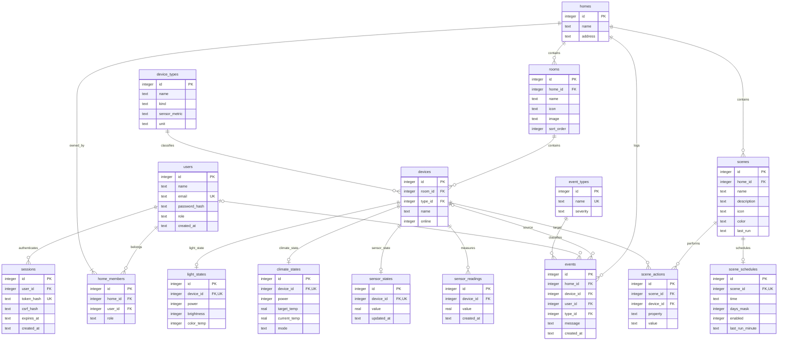

# База данных DOMA

## Хранение и запуск

Сервер использует **SQLite через встроенный `node:sqlite`, `DatabaseSync`** (Node.js 22.17+). Нативных npm-зависимостей SQLite нет. `DB_PATH` по умолчанию — `data/doma.sqlite`. Каталог создаётся автоматически. На каждом соединении включены `foreign_keys`, WAL и `busy_timeout=5000`; идентификаторы — целочисленные первичные ключи. `PRAGMA user_version=2` фиксирует текущую версию схемы.

Разработка создаёт два отдельных приватных дома:

| Роль | Email | Пароль (только разработка) |
|---|---|---|
| Администратор | admin@doma.local | DomaAdmin2026! |
| Пользователь | alex@doma.local | DomaHome2026! |

Гость не читает данные дома: кнопка демо выполняет явный `POST /api/auth/demo`. Регистрация создаёт новый полноценный приватный дом: четыре комнаты, освещение, климат, шесть метрик датчиков, сценарии. Дома разных пользователей не объединяются. Администратор может работать с любым домом и видит их полный список.

В `NODE_ENV=production` демо-вход и автоматическое создание известных учётных записей отключены. Первый запуск пустой базы требует `ADMIN_EMAIL` и `ADMIN_PASSWORD` (минимум 10 символов). Если существующая база содержит известный пароль любой демонстрационной учётной записи, сервер **отказывается запускаться**, не удаляя бизнес-данные. Нужно заменить оба пароля или использовать отдельный `DB_PATH`. Пример секретов из разработки нельзя использовать в рабочей системе.

Резервное копирование работающей WAL-базы следует выполнять SQLite backup API/CLI либо после корректной остановки сервера. Не копируйте только основной файл активной базы: актуальные записи могут находиться в `-wal`.

## ER-диаграмма: 16 таблиц

## Нормализация и явный аргумент 3НФ

**1НФ.** Каждая строка идентифицируется ключом; колонки хранят скалярные значения, нет массивов устройств/действий/участников. Действия сценария и измерения датчика — отдельные строки. Дни расписания сохраняются как **одно значение домена недельного шаблона**, целочисленная битовая маска `days_mask` 1–127 (бит 0 = воскресенье, бит 6 = суббота), а не CSV/JSON-массив. Это фиксированный атрибут расписания, а не таблица повторяющихся дней. API преобразует его в согласованный `days: '0,1,...,6'`. Если отдельным дням понадобятся дополнительные атрибуты, потребуется отдельная relation, которой в текущей предметной области нет.

**2НФ.** Все неключевые атрибуты зависят от полного ключа своей сущности. У `home_members` альтернативный составной ключ `(home_id,user_id)` определяет роль участника; у `scene_actions` `(scene_id,device_id,property)` определяет значение действия. Состояния имеют альтернативный ключ `device_id`; все их свойства зависят от устройства целиком, а не от части какого-либо составного ключа.

**3НФ.** В пределах заданных бизнес-правил нет транзитивной зависимости неключевого атрибута от другого неключевого атрибута:

- Пользователь, дом и членство разделены: имя/email пользователя не дублируются в доме или участниках.
- `devices` хранит `room_id` и `type_id`, но не `home_id`, название комнаты, название типа, класс, метрику или единицу. Эти значения вычисляются JOIN через `rooms`/`device_types`.
- Тип устройства определяет класс, метрику и отображаемую единицу; они находятся в каталоге. Метрика не является глобальным ключом единицы: каталог допускает различные отображаемые единицы для разных типов. Не предполагается скрытое правило `sensor_metric -> unit`.
- Свойства света, климата и датчика отделены от общих свойств устройства, поэтому нет многократно повторяемого набора неприменимых полей.
- `sensor_states` — текущая телеметрия, `sensor_readings` — исторические факты. Они представляют разные отношения (текущее состояние и наблюдение), а не повторяют неключевые данные одного отношения.
- Сценарий, действие и расписание имеют собственные ключи; название устройства/сценария не копируется в действие. Текст `value` является одним скалярным значением выбранного свойства, проверяется согласно классу устройства.
- Уровень важности находится в `event_types`, а не дублируется структурированной колонкой в `events`. Сообщение события — исторический текст факта, не источник актуальных имён сущностей; экран журнала получает актуальные имена отдельным JOIN.
- `last_run` сценария и `last_run_minute` расписания относятся к разным фактам: последний успешный запуск (включая ручной) и последняя попытка планировщика. Одно не определяет другое.

Плоские API-снимки (`Device`, `Scene`, `Event`) — результаты JOIN/проекций, а не денормализованное хранение.

## Ограничения и инварианты

- FK включены постоянно. Пользователь → сессии и членство; дом → комнаты/сценарии/события; устройство → состояния/измерения удаляются каскадно.
- Удаление устройства, на которое ссылается действие сценария, блокируется `RESTRICT`: сначала измените/удалите сценарий. Каталоги типов устройств/событий нельзя удалить, пока они используются.
- Ссылки на пользователя/устройство в историческом журнале становятся `NULL` при удалении объекта, само сообщение сохраняется.
- `UNIQUE`: email (без учёта регистра), хеш сессии, членство пользователя в доме, одно состояние каждого класса на устройство, одно расписание на сценарий, одно действие на сочетание сценарий/устройство/свойство.
- `CHECK`: роли, классы, метрики, битовые состояния, неотрицательный порядок комнат, диапазоны света/климата, часы HH:MM, недельный шаблон, длины строк. Тип датчика обязан иметь метрику и единицу; остальные классы не имеют этих колонок.
- Триггеры блокируют удаление/понижение последнего администратора, удаление/изменение последнего владельца существующего дома и создание состояния неправильного класса. Дом целиком можно удалить: его членства каскадно исчезают.
- Сервер дополнительно проверяет владельца (либо роль администратора), принадлежность вложенных FK одному дому, класс/диапазоны свойств, метрические диапазоны датчиков, действия и расписания. Участник `member` может читать, но изменять дом вправе только `owner`/администратор.
- Перенос устройства между домами запрещён. Перенос комнаты с устройствами или сценария с действиями между домами запрещён. Смена используемого типа на другой класс/метрику запрещена. Смена типа устройства, используемого в действии, запрещена.
- Автоматически создаваемые состояния нельзя создавать/удалять произвольно через admin CRUD; можно изменять проверяемые поля. Сессии доступны только как метаданные, их управление — отзыв сессий пользователя. Таблица остаётся видимой в админке, но токены/хеши не возвращаются.

## Транзакции, время и виртуальная телеметрия

Создание приватного дома, регистрация, добавление устройства со состоянием, изменение/запуск сценария и административные многошаговые операции выполняются через `BEGIN IMMEDIATE`/`COMMIT`; при ошибке `ROLLBACK`.

Запуск сценария сначала проверяет **все** действия, принадлежность дому, доступность устройств и значения. Затем одной транзакцией применяет изменения, пишет события для действий, событие сценария и `last_run`. Недоступное устройство не оставляет частично выполненный сценарий.

Расписания выполняются по часовому поясу процесса Node (`TZ`, либо локальная зона ОС), дни используют JS `getDay()` (0 = воскресенье). Дата события хранится в UTC ISO 8601. Ключ минуты включает локальную дату, время и смещение UTC, отличая повторяющиеся часы перехода DST. `last_run_minute` сохраняется в базе; повторный tick/перезапуск не выполняет тот же график дважды в одной минуте. Неуспешная попытка также отмечается и пишет сообщение об ошибке. Пропущенные при выключенном сервере минуты не догоняются. Изменение существующего расписания сохраняет последний ключ минуты.

Один фоновый tick раз в 60 секунд запускает планировщик, медленный дрейф виртуальных измерений и очистку истёкших сессий. Бинарные датчики не генерируют случайные тревоги. Температура/влажность/CO₂ постепенно дрейфуют к комфортным базовым значениям. Ручная симуляция проверяет диапазоны:

| Метрика | Диапазон | Единица |
|---|---|---|
| temp | −50…70 | °C |
| humidity | 0…100 | % |
| co2 | 250…10000 | ppm |
| motion/contact/leak | 0 или 1 | бинарное состояние |

События симуляции явно обозначены «Симуляция», предупреждения имеют тип `sensor`; обычный автоматический дрейф не засоряет журнал каждую минуту, события появляются при смене состояния тревоги. На устройство сохраняются последние 1000 показаний, endpoint отдаёт последние 240 в хронологическом порядке. `ENABLE_SIMULATION=false` выключает фон и endpoint ручной симуляции; расписания продолжают работать. Это программный виртуальный дом, не интеграция с физическими IoT-устройствами.

## Безопасность API и управление

Пароли — scrypt с отдельной случайной 16-байтной солью и 64-байтным ключом. Cookie содержит случайный 32-байтный непрозрачный токен; база хранит только SHA-256 токена. CSRF-токен производен от случайного cookie и отдельного домена `csrf:`, база хранит только его SHA-256. CSRF возвращается после входа/в `/api/auth/me`, нужен в `X-CSRF-Token` для каждого изменения после входа, включая повторный login/demo/logout. Сравнение хешей — constant-time. Cookie: `HttpOnly`, `SameSite=Lax`, семь дней; в production также `Secure`. Запросы с cross-site `Origin`/`Sec-Fetch-Site` отклоняются. Auth и API имеют rate limit; Helmet включает CSP и заголовки защиты. Размер JSON ограничен 64 KB.

`PUBLIC_ORIGIN` задаёт ожидаемый публичный origin, если прокси меняет Host. `TRUST_PROXY` по умолчанию выключен; `true` означает один доверенный hop, число — количество hops. Включайте только для действительно доверенной цепочки reverse proxy. В development Vite proxy должен сохранять исходный Host (`changeOrigin:false`). CORS не открывается.

Login после асинхронной проверки scrypt повторно читает актуальную учётную запись, не выдаёт сессию на отменённом пароле. Асинхронные изменения профиля/админки повторно проверяют живую сессию непосредственно перед сохранением. Административный сброс пароля отзывает все сессии; отзыв — отдельный endpoint. Самостоятельная смена пароля профиля сохраняет текущую сессию и отзывает остальные. Администратор никогда не получает `password_hash`, `token_hash` или `csrf_hash` в API.

Admin API использует фиксированный реестр **16** допустимых ресурсов и их полей. SQL-идентификаторы берутся только из реестра/проверяемой схемы; пользовательские значения передаются bind-параметрами. Неизвестные/readonly поля отклоняются. Ошибки FK/UNIQUE/защиты последних владельцев возвращаются как понятные 400/409, а не SQL-текст/секреты. Системные типы событий защищены от удаления/переименования.

Журнал поддерживает поиск по сообщению/устройству/комнате, тип, даты, постраничный список и CSV-экспорт тех же фильтров. Поиск экранирует LIKE wildcards и использует bind-параметры. CSV заключает поля в кавычки, удваивает внутренние кавычки и префиксует апострофом значения, начинающиеся с формул (`=`, `+`, `-`, `@`, в том числе после пробелов), предотвращая spreadsheet formula injection.

## Миграции и тестирование

При открытии старой development-базы `sessions.csrf_token` переименовывается в `csrf_hash` с отзывом только старых сессий. CSV `scene_schedules.days` преобразуется в checked `days_mask`, сохраняя ID, время, enabled и ключ последней минуты. Бизнес-данные не сбрасываются; миграции выполняются транзакционно и идемпотентно.

`createApp({dbPath: ':memory:', testing: true})` создаёт изолированное приложение для Supertest **без таймеров**. `app.locals.close()` освобождает соединение; `app.locals.runSchedules(date)` и `app.locals.simulateSensors(date)` позволяют управляемо тестировать время. Серверный entrypoint использует `PORT` (3001 по умолчанию) и в production раздаёт `dist` с корректным Express 5 named wildcard `/{*path}` для SPA.

`tests/backend.test.ts` проверяет auth/hash/CSRF/logout/expiry, регистрацию приватного дома, cross-home authorization, владельца/участника/администратора, CRUD и FK, диапазоны/классы устройств, транзакции сценариев, расписание/ошибки/повтор после перезапуска, метрики и показания, поиск/CSV, metadata/admin safety, отзыв сессий/сброс пароля, схемные ограничения, обе миграции и production fail-safe.
